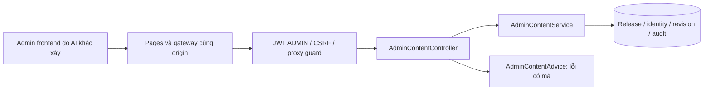

> RBAC 2026-10-24: backend TypeScript có GET `/api/v1/admin/users` và PUT `/api/v1/admin/users/:id/role`; chỉ admin chính được đổi quyền, coadmin chỉ đọc danh sách và vận hành các API quản trị hiện có. Xem [RBAC.md](RBAC.md) cho policy, bootstrap, API và kết quả kiểm thử; không dùng các đoạn Spring Boot lịch sử bên dưới làm hướng dẫn runtime.

# Backend admin — quản trị nội dung đợt A

Hợp đồng phiên bản 0.1.0, ngày 2026-10-20. Frontend do AI khác phụ trách. Đây là bản thiết kế kèm API đã triển khai trong source của đợt này; CD `39385059734` tại `30bb28c` đã thành công; chưa nghiệm thu chức năng production. Đọc [OpenAPI](api/admin-content.openapi.json) để tạo type/client và [ADMIN_PLAN.md](ADMIN_PLAN.md) cho phạm vi dài hạn. Checklist là nguồn trạng thái nghiệm thu.

## Phạm vi

Đợt này có dashboard nội dung, release nháp, clone release, CRUD revision cho nhân vật/bộ thẻ/thẻ/wiki, tìm kiếm/phân trang, xem trước riêng tư, tra cứu ID cố định và đọc nhật ký thay đổi nội dung. Dashboard không trả doanh thu, số đơn hoặc số liệu minh họa.

Import CSV/JSON, xuất bản/rollback lên Pages, quản trị người dùng, upload ảnh, quản trị commerce và hệ thống đối soát/refund còn ở backlog. Backend moderation phản hồi và API public/snapshot đã bổ sung local, hợp đồng riêng tại [FEEDBACK_API.md](FEEDBACK_API.md) và [PUBLIC_CONTENT_API.md](PUBLIC_CONTENT_API.md); chưa nghiệm thu UI/production và chưa nằm trong OpenAPI admin content 0.1.0. Không có API đánh dấu release PUBLISHED, chạy SQL tùy ý hoặc sửa trạng thái PAID. Việc tạo/xem trước nội dung không làm website public thay đổi.

## Cấu trúc và mô hình dữ liệu



- `admin/AdminContentModels`: DTO có Bean Validation; code/slug/pageType cố định, nội dung revision có giới hạn độ dài và enum.
- `admin/AdminContentService`: transaction JDBC giống phần payment, SQL có tham số; tên bảng/cột chỉ đến từ enum nội bộ. Không bổ sung ORM graph, bộ nhớ đệm hoặc service mới ngoài Spring Boot hiện có.
- `admin/AdminContentController`: namespace `/api/v1/admin`; không sửa Angular. SecurityConfig vẫn kiểm tra ADMIN ở backend, bổ sung CORS PUT/DELETE cho API mới.
- `admin/AdminContentAdvice`: lỗi nội dung có `code`, không trả SQL, password hash, giá trị field bị từ chối hoặc toàn bộ request body. Advice ưu tiên trước handler ProblemDetail mặc định để giữ hợp đồng lỗi.
- Flyway V8 chỉ thêm `content_releases.version BIGINT NOT NULL DEFAULT 0` và index status/created_at. Giữ checksum V1–V7; không seed nội dung hoặc user/admin, không thay dữ liệu production trong phiên phát triển.

Một ID cố định (`game_characters`, `card_sets`, `game_cards`, `wiki_pages`) có tối đa một revision trong mỗi release. Code/slug/pageType không đổi qua API này. Revision trong DRAFT có thể sửa; các release PUBLISHED/ARCHIVED chỉ đọc. Để làm bản mới, clone release sang DRAFT: giữ ID/code/slug, tạo ID revision mới, version bắt đầu 0. Lịch sử ở cấp release và audit, không phải một bản chụp đầy đủ cho mỗi lần gõ/sửa trong draft.

DELETE chỉ bỏ revision ở draft, không xóa ID cố định hoặc dữ liệu ở release khác. Nếu nhân vật/bộ thẻ còn được thẻ cùng draft tham chiếu, trả `CONTENT_IN_USE`. API identities tìm được cả ID không còn revision, để thêm lại bằng entityId. Các FK V3 bảo đảm bộ thẻ/nhân vật tham chiếu phải cùng release với thẻ.

## Quyền và giao dịch

Mọi endpoint yêu cầu JWT có role ADMIN. Anonymous nhận 401, CUSTOMER nhận 403. POST/PUT/DELETE cần CSRF cookie và header mới từ `/api/v1/auth/csrf`; production bắt buộc gateway và `X-Origin-Verify` do gateway tự gắn. Frontend không đọc JWT hoặc biết proxy secret, không đặt Authorization/localStorage token riêng.

Trước mỗi mutation, service đọc lại `app_users` để kiểm tra ADMIN, enabled và auth_version; SELECT này không khóa actor. Không dùng FOR UPDATE trên actor vì đã gây deadlock với foreign key created_by khi hai admin cập nhật release đồng thời. Dưới cùng transaction, khóa release, kiểm tra DRAFT + expectedVersion, kiểm tra ID/tham chiếu, thay nội dung, tăng version rồi ghi audit. Bất kỳ lỗi nào rollback cả nội dung, identity mới, version và audit; không có audit SUCCESS cho thao tác thất bại.

`releaseVersion` áp dụng cho **toàn bộ draft**, không riêng một thẻ. Nếu hai admin cùng mở version 3, người lưu trước tăng lên 4; người còn lại nhận 409 VERSION_CONFLICT. Frontend cần tải lại dữ liệu và cho người dùng xem xét trước khi gửi lại; không tự nâng expectedVersion và ghi đè. Version này không phải HTTP ETag và không cần If-Match. Vòng đời JWT 30 phút/thu hồi hiện có không thay đổi.

Đọc nội dung và preview chạy trong transaction REPEATABLE_READ để version, metadata và các revision phản ánh cùng snapshot. Các write vẫn dùng transaction/row lock. Điều này cần được kiểm thử tiếp trên PostgreSQL bằng test subclass disposable; test H2 không thay thế bằng chứng PostgreSQL.

Audit dùng bảng có sẵn: actor UUID, action `CONTENT_*`, loại/ID đối tượng, SUCCESS, thời điểm và chuỗi releaseId/version. Không ghi bài viết, hiệu ứng thẻ, ghi chú release, thông tin liên hệ hoặc secret vào audit. Endpoint audit chỉ đọc các action nội dung; chưa phải nhật ký thất bại/bảo mật hoặc audit toàn hệ thống.

## Danh sách endpoint đã có trong source

Tiền tố `/api/v1/admin`. `{kind}` chỉ nhận `characters`, `card-sets`, `cards`, `wiki-pages`.

| Method | Đường dẫn | Hành vi |
| --- | --- | --- |
| GET | `/dashboard` | Đếm release theo status, feedback NEW, revision thẻ nháp NEEDS_REVIEW; có asOf |
| GET | `/content/releases` | Phân trang, lọc status DRAFT/PUBLISHED/ARCHIVED |
| POST | `/content/releases` | Tạo draft trống, version 0; versionLabel unique |
| GET | `/content/releases/{release}` | Metadata và version |
| PUT | `/content/releases/{release}` | Sửa title/releaseNotes của draft, cần expectedVersion |
| POST | `/content/releases/{release}/clone` | Clone nhất quán, cần sourceVersion và versionLabel mới |
| GET | `/content/releases/{release}/preview` | Snapshot có previewOnly=true; chỉ ADMIN, không phải public export |
| GET | `/content/identities/{kind}` | Tìm ID/code/slug hoặc pageType cố định, kể cả ID đã bỏ khỏi draft |
| GET | `/content/releases/{release}/{kind}` | Danh sách revision, tìm q, phân trang, trả releaseVersion |
| POST | `/content/releases/{release}/{kind}` | Thêm identity + revision mới, hoặc dùng lại entityId có sẵn |
| GET | `/content/releases/{release}/{kind}/{id}` | Chi tiết revision và releaseVersion |
| PUT | `/content/releases/{release}/{kind}/{id}` | Thay toàn bộ trường revision; bỏ optional thì thành null/default |
| DELETE | `/content/releases/{release}/{kind}/{id}?expectedVersion=...` | Bỏ revision khỏi draft |
| GET | `/content/audit-events?releaseId=...` | Nhật ký nội dung có phân trang; releaseId tùy chọn |

POST tạo trả 201; GET/PUT/DELETE trả 200. Response admin đều no-store. DELETE trả `{entityId,releaseVersion}` để frontend giữ version mới. Chưa hỗ trợ PATCH hoặc đổi code/slug, lọc theo bộ thẻ/nhân vật, sort tùy ý hoặc upload file.

Phân trang: `page` bắt đầu 0, tối đa 10000; `size` mặc định 20, tối đa 100; `q` tối đa 100 ký tự. Ký tự `%`, `_`, `!` trong q được tìm như văn bản, không phải wildcard. Revision sắp theo sortOrder, name/title, UUID; identities theo slug, UUID; release/audit theo createdAt giảm dần rồi UUID. Không có offset bất định khi tên trùng.

Ảnh chỉ nhận URL HTTPS có host và không có userinfo, hoặc đường dẫn `/assets/...` không có `..`/backslash. Backend không tải URL và chưa quản lý file. Text được trả dạng text/Markdown; frontend phải render như text hoặc Markdown đã sanitize, không đưa thẳng vào innerHTML/raw HTML.

Preview/clone giới hạn tối đa 2000 revision và 500000 ký tự text lưu trữ để tránh kéo quá nhiều dữ liệu vào RAM. Vượt giới hạn trả 413 PREVIEW_TOO_LARGE; vẫn đọc/sửa được qua API phân trang. Clone dùng batch insert theo loại, characters/sets trước cards. Clone đồng bộ, không phải job bền vững: nếu mất kết nối, tìm lại versionLabel trước khi thử lại để tránh hiểu lầm đã thất bại. Không có idempotency key cho thao tác nội dung ở bản này; label/identity unique và expectedVersion ngăn ghi trùng âm thầm. Gateway vẫn giới hạn body 64 KiB.

## Ví dụ cho AI frontend

Tạo draft:

```http
POST /api/v1/admin/content/releases
Content-Type: application/json
X-XSRF-TOKEN: <token vừa lấy từ /api/v1/auth/csrf>

{"versionLabel":"v2-draft-01","title":"Nội dung V2 đang biên tập","releaseNotes":null}
```

Response có `id` và `version: 0`. Dùng id đó thay `{release}`; đây là ví dụ dữ liệu thử, không phải nội dung game chính thức.

```json
{
  "expectedVersion": 0,
  "code": "BASE",
  "slug": "bo-co-ban",
  "name": "Bộ cơ bản",
  "description": null,
  "sortOrder": 0
}
```

Gửi payload trên tới POST `/content/releases/{release}/card-sets`. Response:

```json
{
  "entityId": "11111111-1111-4111-8111-111111111111",
  "releaseVersion": 1,
  "item": {
    "id": "11111111-1111-4111-8111-111111111111",
    "code": "BASE",
    "slug": "bo-co-ban",
    "revisionId": "22222222-2222-4222-8222-222222222222",
    "releaseId": "33333333-3333-4333-8333-333333333333",
    "name": "Bộ cơ bản",
    "description": null,
    "sortOrder": 0
  }
}
```

Tạo thẻ dùng entityId bộ thẻ vừa nhận và `expectedVersion: 1`. `characterId` có thể null; nếu có thì nhân vật phải được thêm vào cùng draft trước. CardWrite bắt buộc name, effectText, ruleStatus (`CONFIRMED`/`NEEDS_REVIEW`), copiesInDeck từ 1..1000, code và slug. WikiWrite thay code bằng pageType (`STORY`/`RULE`/`GUIDE`/`FAQ`/`DEVLOG`), title và bodyMarkdown. Toàn bộ giới hạn/nullable trong OpenAPI.

Ví dụ gọi từ browser, dùng AuthService hiện có để đăng nhập/khôi phục trạng thái:

```javascript
const csrfResponse = await fetch('/api/v1/auth/csrf', { credentials: 'include' });
if (!csrfResponse.ok) throw new Error('Chưa lấy được CSRF');
const csrf = await csrfResponse.json();
const response = await fetch(`/api/v1/admin/content/releases/${releaseId}/card-sets`, {
  method: 'POST', credentials: 'include',
  headers: { 'Content-Type': 'application/json', [csrf.headerName]: csrf.token },
  body: JSON.stringify(payload),
});
// 401: hết phiên; 403: quyền/CSRF; 409: tải lại và xử lý xung đột; 429/503: chờ/thử lại có kiểm soát.
```

Lỗi domain có dạng ProblemDetail, ví dụ:

```json
{"status":409,"title":"Conflict","detail":"Reload the release before editing again","code":"VERSION_CONFLICT"}
```

| HTTP | code thường gặp | Frontend cần xử lý |
| --- | --- | --- |
| 400 | VALIDATION_FAILED, INVALID_REQUEST, INVALID_QUERY, INVALID_IMAGE_URL | Hiển thị lỗi; validation có errors[].field/message, không có rejectedValue |
| 401/403 | Có thể không có code ở security/gateway | Xử lý theo HTTP status, không phụ thuộc mọi lỗi có cùng body |
| 404 | NOT_FOUND | Đối tượng không còn trong release hoặc kind không được hỗ trợ |
| 409 | VERSION_CONFLICT, RELEASE_IMMUTABLE, IDENTITY_IMMUTABLE | Tải lại; clone release nếu muốn sửa bản đã xuất bản |
| 409 | REFERENCE_NOT_IN_RELEASE, CONTENT_IN_USE, RESOURCE_CONFLICT | Sửa tham chiếu, phụ thuộc hoặc định danh trùng |
| 413 | PREVIEW_TOO_LARGE hoặc giới hạn gateway | Dùng phân trang/giảm payload |
| 429/503 | Có thể không có code | Backoff, thông báo backend đang khởi động; không gửi lặp liên tục |

## Kế hoạch tiếp theo

1. Import JSON/CSV: hợp đồng payload, dry-run có lỗi theo dòng/trường, kiểm tra tham chiếu/ảnh, commit atomic và ID request tránh nhập hai lần.
2. Xuất bản: release được duyệt → snapshot cố định → build frontend theo snapshot → deploy đúng SHA → xác minh public mới cập nhật current release. Cần bảng/job trạng thái và callback nội bộ được bảo vệ; không lấy preview admin làm đường public cho build. Rollback cũng phải xác minh bản tĩnh đã triển khai.
3. Moderation, user/reauth/admin cuối cùng, audit rộng hơn và system status thực tế.
4. Commerce và money workflow sau khi các nền tảng nội dung đã nghiệm thu.

Các endpoint tương lai chưa nằm trong OpenAPI 0.1.0 để tránh frontend gọi nhầm API chưa có. Không thay kiến trúc hosting hoặc thêm dịch vụ trả phí trong đợt này.

## Chạy local và kết quả kiểm tra

Chạy backend bằng Maven Wrapper trong `backend/`, profile mặc định local/H2; Flyway tự áp V1–V8. Không có tài khoản mặc định. Muốn thử UI tích hợp local, người vận hành tự đặt BOOTSTRAP_ADMIN_EMAIL/BOOTSTRAP_ADMIN_PASSWORD bằng tài khoản thử (password ít nhất 12 ký tự, tối đa 72 byte UTF-8) trước startup; BootstrapAdmin chỉ tạo nếu email chưa tồn tại. Không sử dụng mật khẩu hoặc database production để thử. H2 mất dữ liệu khi process dừng. Angular dev proxy `/api` tới 8080; backend và frontend cần chạy cùng cấu hình dev đã có.

Kết quả mới nhất: CI `39384838912` tại `30bb28c` có 104 Maven tests qua, không skipped; 13 admin H2 và 13 admin PostgreSQL disposable qua. Gateway 23 tests qua. Local frontend 40 tests/build qua nhưng còn lệch response contract; xem [báo cáo rà soát](CODEBASE_REVIEW_2026-10-20.md).

OpenAPI đã lint hợp lệ, còn cảnh báo metadata info.license; không tự gán giấy phép. API/V8 đã nằm trong SHA có CD `39385059734` thành công; không còn là source chưa push. Chưa nghiệm thu browser admin production. Phiên rà soát không chạy test ghi trên production.
