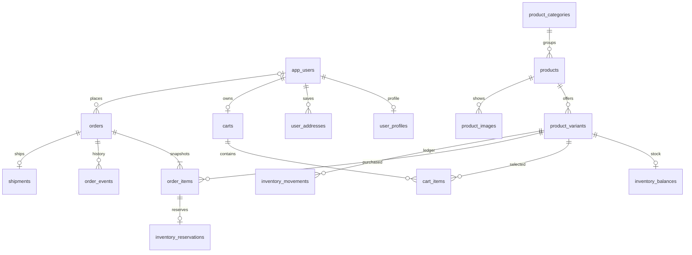
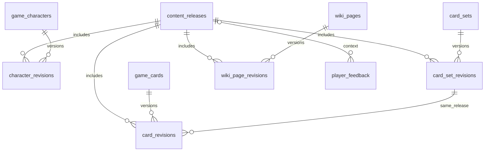
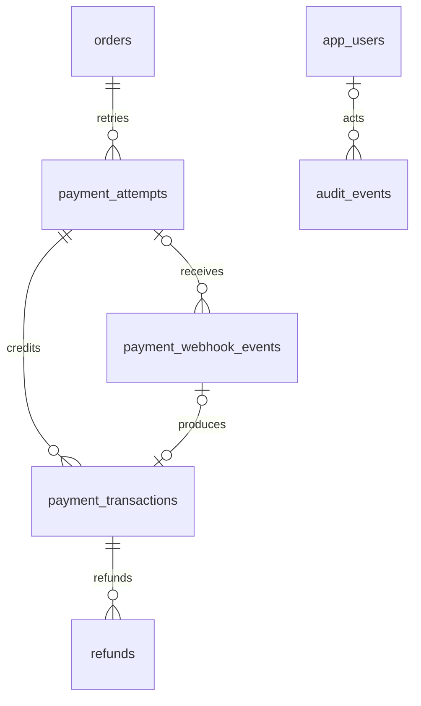

# Thiết kế database — Nhà Này Hơi Báo!

Bản thiết kế nền ngày 19/10/2026; cập nhật source local tới V10 ngày 20/10/2026. PostgreSQL trên Aiven; Spring Boot, Flyway và JDBC transaction. H2 chỉ phục vụ local/test. Source hiện có checkout/orders/PayOS, admin content, public content, feedback và thông báo SSE admin. Catalog/cart API và các phân hệ admin commerce/user/publishing vẫn còn thiếu. Các migration/feature mới còn local trong đợt này; không suy ra database production đã ở V10. Xem PROGRESS.md cho trạng thái deploy thực tế.

V10 bổ sung `admin_notifications` (BIGINT identity, feedback_id unique/FK, created_at) và `admin_notification_reads` (PK notification_id/user_id, read_at; xóa user thì xóa read state). Feedback và notification ghi cùng transaction. Read state riêng từng admin, không có PII trong notification và không giữ connection database trong suốt SSE; chi tiết tại [ADMIN_NOTIFICATIONS.md](ADMIN_NOTIFICATIONS.md). Đây là phần bổ sung sau thiết kế 34 bảng ban đầu.

## Phạm vi và quyết định

- Giữ `app_users` và Spring Session hiện có: email/mật khẩu BCrypt, Google subject, ADMIN/CUSTOMER. Tách thông tin hồ sơ và sổ địa chỉ khỏi credentials.
- Lưu nội dung game theo bản phát hành: nhân vật, 11 bộ thẻ, thẻ, wiki/FAQ/hướng dẫn/devlog. Chưa seed số lượng/giá từ prototype vì đó là dữ liệu minh họa; 148 thẻ có thể là số bản in, cần xác nhận số định danh thẻ khác nhau.
- Shop bán board game, bản mở rộng, phụ kiện qua product → SKU. Mỗi SKU có giá và tồn kho riêng; sản phẩm có thể gắn với phiên bản luật.
- MVP yêu cầu đăng nhập khi checkout, chỉ VND/PayOS, một kho và một kiện giao hàng/đơn. Cart khách chưa đăng nhập có thể ở bộ nhớ trình duyệt; merge khi login bằng API sau này. Chưa có marketplace, chia kho/kiện, COD hay hóa đơn thuế tự động.
- Tiền dùng `BIGINT`, đơn vị **đồng**, không dùng float. Giá bán đã bao gồm thuế nếu áp dụng; nghiệp vụ hóa đơn/thuế phải thiết kế tiếp trước khi phát hành hóa đơn. Checkout có tổng > 0; đơn miễn phí là luồng khác trong tương lai.
- UUID được sinh ở backend; các timestamp có timezone và được chuẩn hóa UTC. Các cột `updated_at`/`version` phải cập nhật trong service; không có trigger tự cập nhật.
- Ba migration cộng thêm V3–V5, không sửa checksum V1/V2, không xóa bảng cũ. Có 30 bảng mới; tổng 34 bảng nghiệp vụ/kỹ thuật cũ và mới, không tính Flyway history.

## Quan hệ tài khoản, đơn hàng và tồn kho



ERD thể hiện hợp đồng nghiệp vụ (đơn phải có ít nhất một dòng hàng); FK chỉ buộc mỗi dòng thuộc một đơn, nên service phải kiểm tra đơn không rỗng trước commit.

| Bảng | Dữ liệu, ràng buộc và mục đích |
| --- | --- |
| `app_users` — đã có | UUID, email unique, password hash nullable cho Google, Google subject unique, display name, role, enabled, ngày tạo. Không trả hash/Google subject cho API khách. Không thêm password plaintext hoặc dữ liệu ngân hàng vào bảng này. |
| `user_profiles` | PK/FK user, điện thoại và avatar URL tùy chọn. Không thu thập ngày sinh/giới tính/CCCD khi chưa có nhu cầu. |
| `user_addresses` | Người nhận, điện thoại, dòng địa chỉ, phường/xã, quận/huyện tùy chọn, tỉnh/thành, mã bưu chính, quốc gia. `default_slot=1` unique theo user; địa chỉ khác để NULL. Không gắn cứng danh mục hành chính có thể thay đổi. |
| `product_categories` | Slug unique, tên và thứ tự: board game, bản mở rộng, phụ kiện… |
| `products` | Slug unique, tên, mô tả Markdown, category, optional release; DRAFT/ACTIVE/ARCHIVED. Archive thay cho xóa sản phẩm đã bán. |
| `product_variants` | SKU unique, tên biến thể, giá VND, trọng lượng, enabled, optimistic version. Mỗi sản phẩm đơn giản vẫn có một SKU mặc định. |
| `product_images` | URL, alt text, thứ tự unique theo product. Chỉ lưu URL; không lưu ảnh binary trong PostgreSQL. |
| `inventory_balances` | Một dòng/SKU: on_hand, reserved, version; CHECK `0 <= reserved <= on_hand`. Có thể bán = on_hand − reserved. SKU ACTIVE cần có dòng inventory trước khi cho checkout. |
| `carts` / `cart_items` | Một cart/user; một dòng/SKU/cart, quantity 1–100. Giá trong cart lấy lại từ catalog, chưa phải giá cam kết và chưa giữ kho. |
| `orders` | Mã hiển thị unique, user nullable chỉ để hỗ trợ gỡ liên kết sau này, checkout key/fingerprint, trạng thái đơn và tiền riêng, tổng tiền, địa chỉ/email snapshot, hạn giữ đơn, version và thời gian. UNIQUE(user, checkout_key). Service bắt buộc user lúc tạo, không dùng user_id nullable để mở guest checkout ngầm. |
| `order_items` | FK SKU và bản chụp SKU/tên sản phẩm/tên biến thể/ảnh/giá/số lượng/giảm giá/thành tiền. UNIQUE(order, SKU). Không sửa dòng sau khi đã tạo payment attempt. FK catalog RESTRICT để không làm mất tham chiếu lịch sử. |
| `inventory_reservations` | Một dòng/order item; giữ toàn bộ quantity của dòng hàng, trạng thái HELD/CONSUMED/RELEASED và expires_at. Không giữ lại quantity thứ hai dễ lệch với order item. |
| `inventory_movements` | Sổ biến động on_hand/reserved, loại nghiệp vụ, người thao tác, order item và operation_key unique chống ghi hai lần. Composite FK buộc SKU khớp dòng hàng. Ghi ledger và balance trong cùng transaction. |
| `order_events` | Timeline chuyển trạng thái, actor, ghi chú và operation_key unique. Append-only theo service. |
| `shipments` | Một kiện/đơn: hãng, mã vận đơn, tracking URL, trạng thái, ngày gửi/nhận. Không tự động giao hàng chỉ vì browser returnUrl báo thành công. |

Snapshot địa chỉ nằm trực tiếp trong `orders`, không trỏ tới `user_addresses`: sửa/xóa địa chỉ đã lưu không thay đổi nơi giao của đơn cũ. Tương tự, giá sản phẩm thay đổi không sửa `order_items`. Đổi địa chỉ trước gửi hàng phải có quy trình được phép và ghi lịch sử, không tự đồng bộ từ hồ sơ.

## Nội dung game có phiên bản



| Bảng | Ý nghĩa |
| --- | --- |
| `content_releases` | Nhãn phiên bản unique, release notes, DRAFT/PUBLISHED/ARCHIVED, published_at. `current_slot=1` unique và chỉ hợp lệ khi PUBLISHED; các bản còn lại NULL. Nhiều bản cũ vẫn PUBLISHED nhưng chỉ một bản là mặc định. |
| `game_characters`, `card_sets`, `game_cards`, `wiki_pages` | Định danh và slug ổn định cho URL/QR. Card/character/set có code unique; wiki có type STORY/RULE/GUIDE/FAQ/DEVLOG. |
| `character_revisions` | Tên, tiểu sử, kỹ năng và ảnh theo release. |
| `card_set_revisions` | Tên/mô tả/thứ tự của bộ thẻ theo release. |
| `card_revisions` | Tên, hiệu ứng, ghi chú luật, CONFIRMED/NEEDS_REVIEW, số bản in, ảnh, bộ thẻ, nhân vật tùy chọn. Composite FK ngăn gắn bộ thẻ/nhân vật thuộc release khác. |
| `wiki_page_revisions` | Tiêu đề, tóm tắt, Markdown, trạng thái luật và thứ tự theo release. |
| `player_feedback` | Góp ý/playtest/câu hỏi luật; user/contact email tùy chọn, tham chiếu version/card/wiki, hàng đợi duyệt và moderator. |

Unique(entity_id, release_id) cho mỗi revision. Service không cho sửa release đã xuất bản: clone nội dung sang DRAFT mới, kiểm tra đầy đủ rồi chuyển `current_slot` trong một transaction. Xác nhận một release có đủ 8 nhân vật/11 bộ/số thẻ đã chốt là validation khi xuất bản, không phải CHECK số hàng cố định trong DB.

Query version V2 phải lọc release V2 xuyên suốt; không ghép mỗi bảng bằng "revision mới nhất" riêng. QR `/the/{slug}` ổn định, có thể thêm `?version=V2`. Với vài trăm thẻ có thể xuất JSON tĩnh và lọc không dấu bằng Angular; chưa cần Elasticsearch/extension PostgreSQL hay Redis.

## PayOS, sổ tiền và hoàn tiền



| Bảng | Dữ liệu và quy tắc |
| --- | --- |
| `payment_attempts` | UUID nội bộ, order FK, request key/fingerprint, provider PAYOS, `provider_order_code` BIGINT identity unique, paymentLinkId unique nullable, checkout URL/QR, số tiền yêu cầu/đã nhận, currency VND, trạng thái nội bộ và provider_status nguyên bản, hạn link và lần đối soát gần nhất. CHECK bắt buộc attempt đang hoạt động có `active_slot=1`, unique theo order; attempt đã đóng bắt buộc NULL. |
| `payment_webhook_events` | Inbox chỉ chứa event đã xác thực chữ ký; orderCode, link ID, reference, amount, currency, mã provider, event_key SHA-256 unique, delivery count, processing/retry status và thời gian. payment_attempt FK nullable nếu event đến trước khi ghép được link. Payload đã lược bỏ PII, giới hạn 16 KiB; không lưu nguyên body ngân hàng vô thời hạn. |
| `payment_transactions` | Sổ tiền thực nhận append-only: attempt FK, reference, số tiền dương, thời gian và source WEBHOOK/RECONCILIATION. UNIQUE(attempt, bank reference) chặn trùng giữa webhook và đối soát. source_event unique, composite FK đảm bảo event thuộc đúng attempt. |
| `refunds` | Ghi yêu cầu/duyệt/thực hiện hoàn tiền theo transaction gốc; idempotency key unique, số tiền, lý do, người duyệt, tham chiếu chứng từ và trạng thái. Thành công cần external_reference + completed_at. MVP là quy trình chuyển khoản có kiểm soát, **không giả định API payment requests của PayOS có thao tác refund**. |
| `audit_events` | Ai làm gì với user/content/order/payment, kết quả và ghi chú đã bỏ thông tin nhạy cảm. entity_id là tham chiếu audit đa loại, không phải FK. Chưa có DB trigger chống sửa; quyền ghi và chính sách append-only phải được thực thi trong service/quyền DB. |

`orders.id` (UUID), `order_number` (mã hiển thị) và PayOS `orderCode` (số nguyên) là ba giá trị khác nhau. Mỗi attempt mới được cấp orderCode mới bằng identity, không dùng timestamp mili giây dễ trùng. Retry tạo link đang UNKNOWN phải dùng lại orderCode đó để tra cứu; không cấp mã mới chỉ vì timeout.

Giới hạn orderCode <= 2^53−1 là lựa chọn của ứng dụng để giữ chính xác khi qua JSON/JavaScript, không phải khẳng định giới hạn riêng của PayOS. Giới hạn tiền 10^12 đồng và quantity 100 là guardrail của shop, có thể đổi bằng migration khi nghiệp vụ yêu cầu.

`amount_received` là cache của SUM(payment_transactions.amount), cập nhật cùng ledger trong transaction. Không trừ tiền hoàn khỏi ledger nhận tiền: hoàn tiền có bảng riêng. Số tiền đơn thu được = tổng các transaction của tất cả attempts; số đã hoàn = tổng refunds SUCCEEDED. Khoản hoàn đang APPROVED/PROCESSING cũng phải chiếm hạn mức để không duyệt hai yêu cầu vượt tiền đã thu.

### Trạng thái

| Đối tượng | Luồng chính |
| --- | --- |
| Order | PENDING_PAYMENT → CONFIRMED → PROCESSING → SHIPPED → COMPLETED; hủy theo chính sách ở service |
| Payment status của order | UNPAID → PARTIALLY_PAID → PAID; có REVIEW, REFUND_PENDING, PARTIALLY_REFUNDED, REFUNDED |
| Payment attempt nội bộ | CREATING → PENDING → PARTIALLY_PAID/PAID; CANCELLED/EXPIRED/FAILED; UNKNOWN khi kết quả API chưa rõ |
| Reservation | HELD → CONSUMED khi chốt bán, hoặc HELD → RELEASED khi đã xác nhận có thể bỏ giữ hàng |
| Refund | REQUESTED → APPROVED → PROCESSING → SUCCEEDED; có REJECTED/FAILED |

PARTIALLY_PAID và UNKNOWN là trạng thái nội bộ do ứng dụng định nghĩa; không suy diễn PayOS API trả cùng tên. `provider_status` được lưu riêng để đối chiếu. DB CHECK chặn giá trị sai, nhưng **chưa chặn mọi đường chuyển trạng thái**; service phải dùng conditional update/locking và audit.

### Tạo đơn và giữ kho

1. Bắt buộc login và CSRF; nhận SKU/quantity, không tin giá/tổng tiền/role do Angular gửi. Tải catalog đang bán, kiểm tra địa chỉ thuộc user, tính vận chuyển/giá/khuyến mại ở backend. Khi chưa có coupon engine, không chấp nhận mã/discount từ browser; snapshot coupon để sẵn cho giai đoạn sau.
2. Cùng checkout_key và cùng fingerprint trả lại đơn cũ; cùng key nhưng khác cart/địa chỉ từ chối 409. Khóa cart/kiểm tra version; giữ SKU theo thứ tự UUID để hạn chế deadlock.
3. Trong **một DB transaction**: tạo order/items snapshot, giữ tồn kho bằng conditional UPDATE, tạo reservation và ledger RESERVE. Kiểm tra tổng line_total đúng subtotal. Một SKU hết hàng thì rollback toàn bộ, không để đơn nửa vời.

```sql
UPDATE inventory_balances
SET reserved = reserved + :quantity, version = version + 1,
    updated_at = CURRENT_TIMESTAMP
WHERE variant_id = :sku_id AND on_hand - reserved >= :quantity;
-- Phải có affectedRows = 1; SELECT kiểm tra rồi UPDATE riêng không đủ chống race.
```

4. Commit trước khi gọi PayOS; không giữ lock DB trong lúc chờ mạng. Chỉ giảm on_hand khi chốt bán: on_hand − quantity, reserved − quantity, reservation CONSUMED, movement SALE unique operation key trong cùng transaction.

### Tạo link PayOS và xử lý timeout

1. Lock order; xác nhận còn được thanh toán, số tiền đúng tổng đã khóa, chưa có attempt active. Tạo CREATING với active_slot=1 và orderCode identity; commit.
2. Gọi API PayOS bằng credentials server, signature theo SDK chính thức. description tạo ở server theo giới hạn kênh/ngân hàng (không lấy tự do từ tên sản phẩm). Return/cancel URL phải từ cấu hình hostname cho phép, không nhận URL tùy ý từ client.
3. Thành công: lưu link ID/checkout URL/QR/status/expiry; chỉ cập nhật nếu attempt chưa được webhook chốt PAID. Không để response API đến muộn ghi đè trạng thái mới.
4. Timeout/không biết kết quả: UNKNOWN vẫn giữ active_slot=1. Đối soát GET bằng orderCode trước khi retry/cấp attempt mới. Lỗi chắc chắn không tạo link mới được đóng FAILED và bỏ active slot.
5. Khi đổi attempt, hủy/xác minh trạng thái link cũ trước. Tiền đến từ link cũ vẫn phải ghi nhận; active_slot không phải bằng chứng link cũ không thể nhận tiền.

### Webhook và đối soát

Endpoint dự kiến `POST /api/v1/payments/payos/webhook`; **chưa mở endpoint trong gateway/Spring Security**. PayOS là server nên không có Origin/Fetch Metadata hay Turnstile. Khi triển khai cần ngoại lệ chính xác cho endpoint này, giới hạn body/rate riêng, bỏ CSRF riêng webhook và bắt buộc verifier PayOS trước mọi thay đổi dữ liệu; không bỏ bảo vệ các đường dẫn payment còn lại.

1. Giới hạn body; xác minh HMAC/signature bằng SDK chính thức với checksum key. Chỉ tin dữ liệu đã verified; test/confirmation webhook xử lý riêng, không tạo đơn/ghi tiền từ dữ liệu mẫu. Reject payload giả, loại tiền không hỗ trợ và mã nghiệp vụ không hợp lệ.
2. Tìm attempt theo orderCode, đối chiếu link ID/currency và cấu hình merchant channel. Nếu event đến sớm, lưu inbox verified, ghép và retry sau. Không chọn order bằng ID query string ở returnUrl.
3. event_key = SHA-256 canonical **verified data**. Upsert duplicate tăng delivery count, không đặt lại PROCESSED. Inbound chưa xác thực chỉ ghi chỉ số/log đã làm sạch; không ghi vô hạn vào DB Free.
4. Lock order trước attempt theo thứ tự thống nhất cho mọi luồng. Trong cùng transaction: insert transaction với unique bank reference; chỉ khi insert mới thành công mới cộng tiền, cập nhật trạng thái, tiêu thụ kho và ghi order event. Nếu tổng đã có đủ tiền từ attempt khác, event mới không được tiêu thụ kho lần hai.
5. Chỉ CONFIRMED khi nhận **đúng số tiền phải thu**, đơn còn hợp lệ và reservation còn giữ. Thiếu tiền giữ PARTIALLY_PAID và chờ đối soát; dư tiền, link sai, tiền đến sau cancel/expiry hoặc stock đã nhả → REVIEW, không tự giao hàng/hồi sinh đơn. Ledger vẫn lưu khoản tiền thực nhận. DB cho phép amount_received lớn hơn amount_requested để không che mất khoản dư.
6. Chỉ trả 2xx sau khi event đã commit vào inbox/transaction; DB lỗi trả lỗi để provider retry. Xử lý trùng phải thành công idempotent. Sau đó job có thể retry inbox theo status/next_attempt_at.
7. ReturnUrl/cancelUrl chỉ phục vụ điều hướng/UI. Backend đọc trạng thái DB hoặc đối soát API; URL `status=PAID` hay người dùng bấm hủy không chứng minh đã nhận/hủy tiền.
8. Đối soát định kỳ và khi người dùng bấm kiểm tra thanh toán; ghi cùng ledger với UNIQUE(attempt, reference). Chuỗi thời gian provider thiếu offset phải được parse theo timezone đã xác nhận với provider/cấu hình merchant rồi lưu UTC, không lấy timezone của server.

Render Free có thể ngủ: thiết kế inbox + đối soát là cần thiết; không dựa vào scheduler trong JVM đang ngủ để giải phóng hàng đúng phút. Khi làm API phải thêm trigger định kỳ bên ngoài hoặc job phù hợp và lazy reconciliation ở checkout/tra cứu. Chưa tạo automation/cron trong phiên thiết kế DB này.

### Hết hạn, hoàn tiền và đối chiếu tồn kho

- Hết hạn local không đủ để coi PayOS chưa nhận tiền. Kiểm tra provider/cancel, lock order/reservation, kiểm tra vẫn HELD rồi nhả reserved và ghi RELEASE một lần. Race webhook/expiry xử lý trong transaction theo cùng thứ tự lock. Tiền đến sau nhả kho → REVIEW và hoàn thủ công nếu không đáp ứng hàng.
- Refund: lock transaction gốc, tính tổng đã hoàn + các khoản được duyệt/đang xử lý, bảo đảm không vượt tiền nhận. UNIQUE idempotency_key ngăn request lặp; external reference unique hỗ trợ tránh ghi chứng từ hai lần. Không trừ tồn kho/tăng stock chỉ vì tạo refund; chỉ ghi RETURN khi hàng được nhận/kiểm tra theo chính sách.
- Cache balance/amount_received và trạng thái phải có job đối chiếu ledger. CHECK/FK không thể tự đảm bảo SUM liên bảng. SQL không có trigger hiện tại để tự tổng hợp.

## Những gì DB bảo vệ và những gì service phải làm

| DB đang cưỡng chế | Service bắt buộc triển khai tiếp |
| --- | --- |
| Unique email/Google subject, một địa chỉ mặc định/user | Phân quyền/ownership, chuẩn hóa email/phone, xác minh email, an toàn avatar URL |
| Total = subtotal + shipping − discount; line total = quantity × price − line discount | Subtotal bằng SUM(lines), giá catalog đúng, SKU đang bán, cart/order không rỗng, đơn bị khóa sau tạo link |
| Reserved không âm/không vượt on_hand; movement SKU khớp order item | Reservation/ledger/balance cập nhật atomically, không double consume/release, rollback khi một SKU hết hàng |
| Một active attempt/order; orderCode/link ID/request key unique | Attempt amount đúng order, chữ ký PayOS thật, link ID/orderCode matching, UNKNOWN/reconciliation, transition hợp lệ |
| Event hash unique, reference/attempt unique, event không gắn sai attempt | So tiền đủ/thiếu/dư, chống duplicate credit giữa attempts bằng đối soát merchant reference phù hợp, xử lý late payment/replay |
| Refund thành công cần chứng từ, amount dương | Tổng hoàn không vượt khoản đã nhận; xác minh tiền đã hoàn thật, phân quyền người duyệt |
| Revision không trộn release, chỉ một current release | Published content bất biến, dữ liệu release đầy đủ, sanitize Markdown/URLs trước render |

Schema hiện dành cho **một PayOS merchant channel**. Nếu thêm nhiều kênh, cần thêm channel identity và đưa vào unique keys/reconciliation trước khi vận hành, không tái dùng orderCode tùy ý giữa database/service độc lập. Cross-attempt reference cần so merchant/order link để tránh hạch toán một giao dịch sang hai attempts khi provider data sai; không suy diễn reference unique toàn hệ thống ngân hàng nếu chưa xác nhận contract.

## Index, dữ liệu cá nhân và vận hành Free

- Index theo các query chính: orders(user, created), orders(status, expiry), cards(release, set), feedback(status, created), reservation(status, expiry), payment(status, last_reconciled), inbox(status, next_attempt), ledger(attempt, reference), timeline(order, created). Unique/FK quan trọng có index tương ứng hoặc index composite với cột đầu phù hợp.
- Không lưu Client ID/API key/checksum key PayOS trong bảng, repo hoặc client Angular. Đặt ở Render secrets; worker chỉ nhận origin secret, không cần PayOS API key.
- DB chứa PII nên chỉ backend truy cập; API theo user hiện tại, không tin user_id từ request. Logs/audit bỏ password, cookies, token, số tài khoản ngân hàng và địa chỉ đầy đủ. Payload inbox lưu bản đã lọc, không lưu nguyên webhook vô thời hạn.
- Gỡ liên kết user dùng SET NULL cho orders/audit, CASCADE cho profile/address/cart. Snapshot đơn và payment ledger cần quy trình lưu giữ/ẩn danh riêng do chủ dự án chốt; xóa user không tự xóa mọi PII trong order. Mặc định khóa account bằng enabled thay vì hard delete.
- Chưa có DB role riêng đọc/ghi hoặc immutable-table privileges; production cần triển khai cùng API trước khi mở bán. `append-only` trong tài liệu là yêu cầu service, không phải trigger/quyền DB đã có.
- Aiven Free giới hạn dung lượng: ảnh chỉ lưu URL, không lưu mỗi lần nhận webhook thành một row mới; dọn session hết hạn và inbox/audit theo retention đã chốt; chưa bật event logging cho mọi request. Giữ pool tối đa 3 như hiện tại. Cần backup/restore được kiểm tra trước bán hàng thật.

## Migration và kiểm tra

| Migration | Phần dữ liệu |
| --- | --- |
| V1/V2 — đã có | Metadata, auth users và Spring Session |
| `V3__customer_profiles_and_game_content.sql` | User profile/address và nội dung game versioned/feedback |
| `V4__catalog_checkout_and_inventory.sql` | Catalog, SKU, inventory, cart, order snapshot, shipment và timeline |
| `V5__payos_payment_ledger_and_audit.sql` | PayOS attempts, verified inbox, tiền nhận, refunds và audit |
| V6/V7 | Password reset digest và auth_version thu hồi JWT |
| V8/V9 | Version release nháp, version/ghi chú moderation phản hồi |
| `V11__seed_pokemon_hoang_nam_product.sql` | Seed một sản phẩm thử: thẻ Pokémon Hoàng Nam, 2.000 VND, tồn 10 (kèm dòng RECEIVE trong ledger) |
| `V10__admin_notifications.sql` | Notification admin theo feedback và read state riêng mỗi tài khoản |

`DatabaseSchemaTests` chạy nâng V2 → V11 (9 migration) giữ dữ liệu user cũ, Flyway validate/idempotence, constraints, dedup, snapshots và hai buyer đồng thời. Luôn test H2; nếu có biến `SCHEMA_TEST_JDBC_URL/USERNAME/PASSWORD`, test thêm PostgreSQL trong schema ngẫu nhiên `exe_schema_test_<12 hex>` và xóa đúng schema đó khi xong. Không gọi Flyway clean, không migrate public schema Aiven khi chạy contract test.

CI backend có PostgreSQL 18 disposable để kiểm tra thật, không dùng secret database production. Chạy local: `.\mvnw.cmd -B -ntp test` hoặc `-Dtest=DatabaseSchemaTests test`. Session/credentials cũ vẫn phải qua các test auth hiện có.

H2 được pin 2.5.250 để sửa lỗi CHECK constraint khi kết nối tạo schema đã đóng; giữ nguyên ràng buộc dữ liệu thay vì vô hiệu CHECK trong test. Xem [H2 2.5.250, fix #4302](https://github.com/h2database/h2database/releases/tag/version-2.5.250). Flyway hiện vẫn phát cảnh báo version H2 mới hơn danh sách đã xác minh; contract tests kiểm tra migration và hành vi thực tế của phiên bản này.

Migration nằm trong backend nên sẽ được Flyway tự áp dụng khi bản chứa migration được deploy. Trong phiên thiết kế chỉ kiểm tra schema riêng; việc commit/push/release phải ghi rõ để tránh hiểu nhầm public Aiven đã được thay đổi. Chưa có entity/repository/service/API shop, PayOS SDK, webhook verifier hay credentials merchant thật.

## Nguồn đối chiếu PayOS

- [PayOS API: tạo/tra cứu/hủy link, webhook](https://payos.vn/docs/api/): orderCode, paymentLinkId, amount, reference, checkoutUrl/QR và trạng thái provider.
- [Xác minh chữ ký webhook](https://payos.vn/docs/tich-hop-webhook/kiem-tra-du-lieu-voi-signature/): HMAC SHA-256, canonical sorted data; nên dùng SDK chính thức thay vì tự ghép JSON tùy ý.
- [Return URL](https://payos.vn/docs/du-lieu-tra-ve/return-url/): dữ liệu chuyển hướng trình duyệt; không dùng riêng dữ liệu đó để ghi nhận thanh toán.

### Kết quả xác minh phiên thiết kế

- Full backend suite: 28 tests pass (10 auth/smoke và 18 contract tests H2/PostgreSQL).
- Sau khi bổ sung kiểm tra upgrade giữ user cũ và siết active_slot: chạy lại 18 contract tests trên bản cuối, 0 failures/errors.
- PostgreSQL thực tế: Aiven 18.6, TLS verify-full, schema test riêng; migration từ V2 lên V5, chạy lại không phát sinh migration và Flyway validate thành công.
- Cuối phiên thiết kế 19/10, thay đổi còn local và chưa áp dụng production; đây là ghi nhận lịch sử. Trạng thái release mới ở mục dưới.

### Release production — 20/10/2026

- Đã push schema ở commit 42d32ba và triển khai tự động qua [CI #39296229959](https://github.com/thanhdo257205/EXE_WebApplication/actions/runs/39296229959) → [CD #39296516356](https://github.com/thanhdo257205/EXE_WebApplication/actions/runs/39296516356). Toàn bộ job, bao gồm Deploy tested commit, thành công.
- CI thực tế: backend 28 tests pass với PostgreSQL 18 disposable; gateway/frontend/build và Docker smoke 512 MB pass.
- Aiven production đã áp dụng V3, V4, V5; JDBC kiểm tra Flyway V5, 34 bảng ứng dụng, không có migration lỗi và không còn schema thử nghiệm. Dữ liệu tài khoản không đổi.
- API qua Pages báo đúng SHA được test; Pages production deployment và Render deploy đều khớp SHA. Smoke website/API/health/guard pass. Schema PayOS đã có, API mua hàng/PayOS vẫn chưa triển khai và chưa có giao dịch tiền thật.


## Bổ sung auth local 2026-10-20 — V6/V7, chưa deploy

- V6: `password_reset_tokens` có user_id PK/FK cascade, token_hash SHA-256 unique, requested_at/expires_at có timezone và constraint expiry. Một link mỗi tài khoản, TTL 15 phút, cooldown 60 giây. Không lưu raw token; row hết hạn được thay thế khi yêu cầu lại, không vượt số tài khoản.
- V7: `app_users.auth_version BIGINT NOT NULL DEFAULT 0`. JWT chứa subject UUID và phiên bản; mỗi request kiểm tra enabled/quyền/version bằng SELECT. Logout và reset tăng version thu hồi mọi JWT tài khoản.
- Đăng nhập không ghi session JDBC; giữ bảng Spring Session cho state OAuth ngắn hạn. Reset xóa cả session legacy/OAuth theo email/sub khi có principal.
- Cấp và dùng reset link khóa `app_users FOR UPDATE` trong transaction. Hai lần reset đồng thời chỉ một thành công; gửi mail lỗi rollback replacement, link trước còn hợp lệ. Chỉ hỗ trợ enabled đã có password hash; không tự thêm mật khẩu cho Google-only.
- V1–V5 giữ checksum. Production trước phiên này ghi nhận V5/34 bảng; local sau V6 có 35 bảng ngoài Flyway. Chưa áp V6/V7 lên Aiven trong phiên này.


## V8 — phiên bản draft cho admin content (2026-10-20, chưa deploy)

V8 thêm content_releases.version BIGINT NOT NULL DEFAULT 0 CHECK version >= 0 và index status/created_at. Không đổi checksum V1–V7, không tạo bảng mới hoặc seed dữ liệu. Mỗi mutation revision/metadata tăng version của toàn draft; expectedVersion bắt buộc để phát hiện xung đột. Khóa app_users của actor trước release, kiểm tra ADMIN/enabled/auth_version ngay trong transaction; dữ liệu và audit cùng commit/rollback. Các read bundle dùng REPEATABLE_READ.

Identity/code/slug/pageType không đổi; bản đã PUBLISHED/ARCHIVED không sửa. Clone tạo release DRAFT version 0 và revision IDs mới, giữ identity IDs, copy characters/sets trước cards để giữ FK cùng release. DELETE chỉ bỏ draft revision; không xóa identity hoặc revision release khác. Chưa có thay đổi current_slot hoặc publish pipeline. Chi tiết [ADMIN_BACKEND.md](ADMIN_BACKEND.md).
